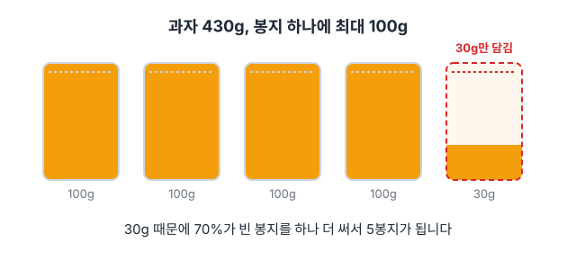
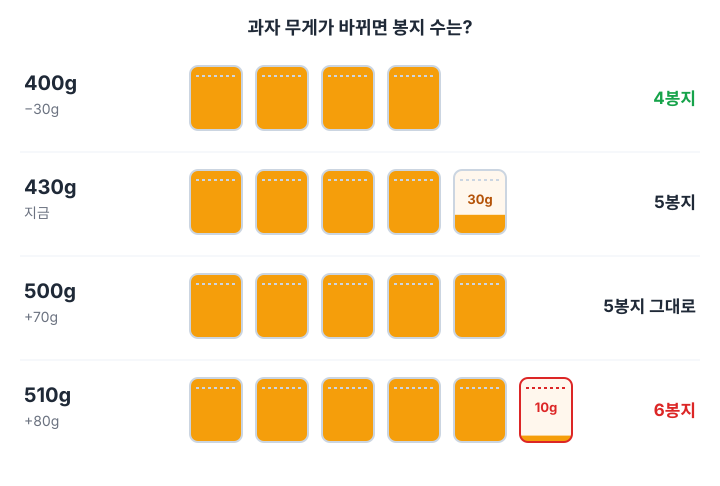
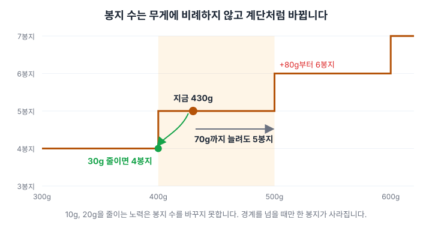

# 이 스킬을 쓰면 뭐가 좋은가?

> 번들이나 이미지를 줄이면 페이지가 빨라질까요? 줄이는 양이 "경계"를 넘을 때만 빨라집니다. 이 스킬은 그 경계가 어디인지 알려 줍니다.

네트워크 용어 없이 과자 봉지로 먼저 설명하겠습니다.

## 과자를 봉지에 나눠 담는다면

과자가 430g 있고, 봉지 하나에는 최대 100g까지 담을 수 있습니다. 몇 봉지가 필요할까요?

100g씩 4봉지를 채우고 남은 30g을 담으려면 봉지가 하나 더 필요합니다. 마지막 봉지는 70%가 비어 있는데도 봉지 하나를 통째로 씁니다. **30g 때문에 5봉지가 된 것입니다.**

## 30g 줄이면 4봉지, 70g까지 늘려도 5봉지

과자 무게를 조금씩 바꿔 보면 봉지 수는 이렇게 바뀝니다.

| 과자 무게 | 지금과 비교 | 봉지 수 |
| --- | --- | --- |
| 400g | 30g 줄임 | **4봉지** |
| 420g | 10g 줄임 | 5봉지 (그대로) |
| 430g | 지금 | 5봉지 |
| 500g | 70g 늘림 | 5봉지 (그대로) |
| 510g | 80g 늘림 | **6봉지** |

그래프로 보면 봉지 수는 무게에 비례해서 조금씩 줄지 않고, 계단처럼 한 번에 바뀝니다.

여기서 알 수 있는 것은 두 가지입니다.

- **30g을 줄이면 봉지 하나가 사라집니다.** 반대로 10g, 20g을 줄이는 노력은 봉지 수를 바꾸지 못합니다.
- **70g까지는 늘려도 괜찮습니다.** 과자를 조금 더 넣어도 봉지 수는 그대로입니다.

이 두 숫자를 알면 "어디까지 줄여야 의미가 있는지"와 "어디까지 늘려도 괜찮은지"를 감이 아니라 숫자로 정할 수 있습니다.

## 웹페이지에서는

페이지를 처음 열 때 서버도 파일을 봉지에 나눠 담듯이 보냅니다. 한 번에 다 보내지 않고, 왕복(RTT) 한 번에 보낼 수 있는 양만큼씩 나눠 보냅니다.

| 과자 비유 | 웹페이지 |
| --- | --- |
| 과자 무게 | 번들(JS·CSS)과 이미지의 압축 후 크기 |
| 봉지 하나 | 서버가 왕복 한 번에 보낼 수 있는 양 |
| 봉지 수 | 왕복 횟수(RTT) = 로딩 시간을 정하는 단위 |

그래서 번들을 줄이는 작업이 실제로 로딩을 빠르게 하는지는 **"봉지 수(왕복 횟수)가 줄었는가"**로 정해집니다. 이 스킬은 배포된 페이지를 실제로 측정해서 과자 예시의 두 숫자를 알려 줍니다.

| 과자 예시 | 스킬 결과 표의 열 | README 결과 예시의 값 |
| --- | --- | --- |
| 30g 줄이면 4봉지 | 1 RTT 줄이려면 | 권장 −100.0kB |
| 70g까지 늘려도 5봉지 | 다음 RTT까지 여유 | 68.3kB |

## 이런 판단에 씁니다

**이미지 리사이징**
히어로 이미지를 WebP로 바꾸거나 해상도를 낮추기 전에, 그만큼 줄이면 왕복이 줄어드는지 먼저 확인합니다. 40kB를 줄여도 경계에 못 미치면 왕복 횟수는 그대로입니다. 그때는 이미지를 조금 더 줄여 경계를 넘길지, 다른 최적화에 시간을 쓸지 정할 수 있습니다.

**번들 크기 줄이기**
코드 스플리팅, 라이브러리 교체, 트리 셰이킹처럼 손이 많이 가는 작업을 할지 정할 때 씁니다. "100kB를 줄여야 1 RTT가 준다"는 걸 알면, 30kB를 줄이는 리팩터링은 로딩 속도 관점에서는 효과가 없다는 것을 미리 알 수 있습니다.

**라이브러리 추가**
반대로 새 라이브러리를 넣을지 고민될 때도 씁니다. 압축 후 12kB인 라이브러리를 넣어도 여유가 68kB라면 왕복 횟수는 늘지 않습니다. 코드를 깔끔하게 만드는 쪽을 골라도 됩니다.

**최적화 결과 설명하기**
"크면 느리니까 줄였다"가 아니라 "2단계 리소스가 3 RTT였는데 98kB를 줄여 2 RTT가 된 것을 패킷으로 확인했다"라고 근거를 댈 수 있습니다. PR 설명, 회고, 면접에서 그대로 쓸 수 있습니다.

## 실제 봉지와 다른 점

과자 봉지는 크기가 항상 100g이지만, 서버의 "봉지"는 처음에 작게 시작해서 왕복할 때마다 약 2배씩 커집니다(TCP 슬로 스타트). 처음 크기도 서버와 CDN마다 다릅니다. 그래서 경계가 400g, 500g처럼 고르게 있지 않고, 서버마다 위치가 달라서 계산만으로는 알 수 없습니다.

이 스킬이 배포된 페이지를 직접 열어 패킷을 세는 이유가 이것입니다. 내 서버의 봉지가 실제로 얼마나 크고 어떻게 커지는지 재서 경계를 찾습니다. 자세한 원리는 [README의 "왜 RTT로 봐야 하나"](../README.md#왜-rtt로-봐야-하나)에, 결과 표를 읽는 방법은 [결과 읽는 법](reading-results.md)에 있습니다.
